# ỨNG DỤNG THUẬT TOÁN PURE PURSUIT TRONG ĐIỀU KHIỂN ROBOT VẬN CHUYỂN HÀNG HÓA TRONG NHÀ MÁY VÀ KHO THÔNG MINH

**Đồ án môn học Kỹ thuật Robot** · **Python** · **Pure Pursuit** · **P/PID** · **Mô phỏng bám quỹ đạo**

<p align="center">
  
</p>

## 1. Nội dung đề tài

Đề tài xây dựng chương trình mô phỏng robot vận chuyển hàng hóa bám theo quỹ đạo định trước trong môi trường nhà máy và kho thông minh. Mô hình động học **bicycle** mô tả chuyển động của xe, **Pure Pursuit** tính góc lái và bộ điều khiển **P/PID** điều chỉnh vận tốc. Cấu hình thứ ba giảm vận tốc đặt theo độ cong để khảo sát ảnh hưởng của việc giảm tốc khi vào cua.

**Ba cấu hình điều khiển**

| Cấu hình | Điều khiển hướng | Điều khiển vận tốc |
|---|---|---|
| **1 – PP + P** | Pure Pursuit | P |
| **2 – PP + PID** | Pure Pursuit | PID |
| **3 – PP + PID + giảm tốc cua** | Pure Pursuit | PID, điều chỉnh vận tốc đặt theo độ cong |

**Ba kịch bản mô phỏng**

| Kịch bản | Quỹ đạo | Nội dung khảo sát |
|---|---|---|
| **1** | Đường thẳng (0 cua) | Tăng tốc, duy trì vận tốc và dừng tại đích |
| **2** | Chữ L (1 cua 90°) | Sai số bám đường và biến thiên vận tốc khi vào cua |
| **3** | Zíc zắc (5 cua 90°) | Bám đường qua các cua liên tiếp và kiểm tra vượt biên |

Trong mỗi kịch bản, ba cấu hình dùng cùng hình học xe, tuyến tham chiếu và giới hạn mô phỏng. Các chỉ tiêu gồm **RMS(t)**, **RMS(ds)**, **RMS(s)** trên miền tiến độ tuyến chung, sai số cực đại, thời gian chạy, khoảng cách đến đích, vận tốc cuối và trạng thái vượt biên hành lang.

Đề tài khảo sát thêm ảnh hưởng của khoảng nhìn trước trên tuyến zíc zắc bằng cách thay đổi khoảng nhìn trước cơ sở **Lfc** trong cấu hình **PP + PID**.

## 2. Hướng dẫn cài đặt và chạy

Yêu cầu **Python 3.9 trở lên**. Từ thư mục gốc của repository, chạy các lệnh sau.

```bash
cd Robotics_final/Path_tracking
python -m pip install numpy matplotlib pillow
```

| Lệnh chạy trong `Path_tracking/` | Chức năng |
|---|---|
| `python main.py` | Mở giao diện mô phỏng |
| `python main.py --experiment-all` | Chạy 9 lượt so sánh ba cấu hình trên ba quỹ đạo, xuất GIF, PNG và CSV |
| `python experiment.py --lookahead` | Khảo sát ba mức Lfc trên tuyến zíc zắc, xuất GIF, PNG và CSV |
| `python main.py --self-test` | Kiểm tra các chức năng mô phỏng |

Kết quả được lưu trong [`Path_tracking/results/`](Robotics_final/Path_tracking/results/). Các file khảo sát Lfc nằm trong [`results/zigzag/`](Robotics_final/Path_tracking/results/zigzag/).

## 3. Kết quả mô phỏng trực quan

### Kịch bản 1 – Đường thẳng

| PP + P | PP + PID | PP + PID + giảm tốc cua |
|:---:|:---:|:---:|
| 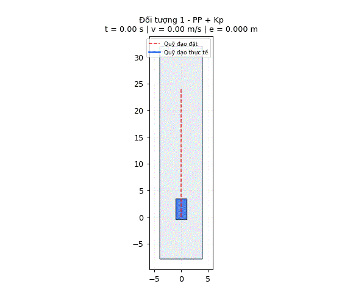 | 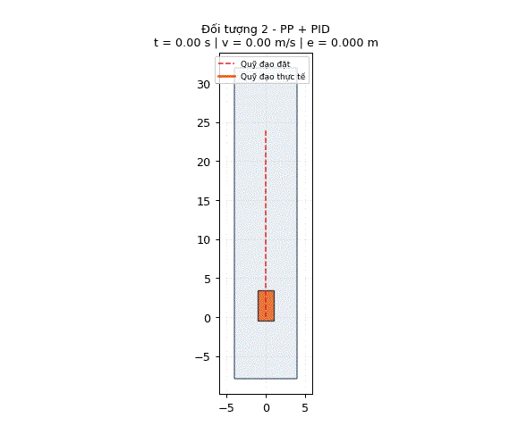 |  |

**Quỹ đạo thực tế của ba cấu hình**

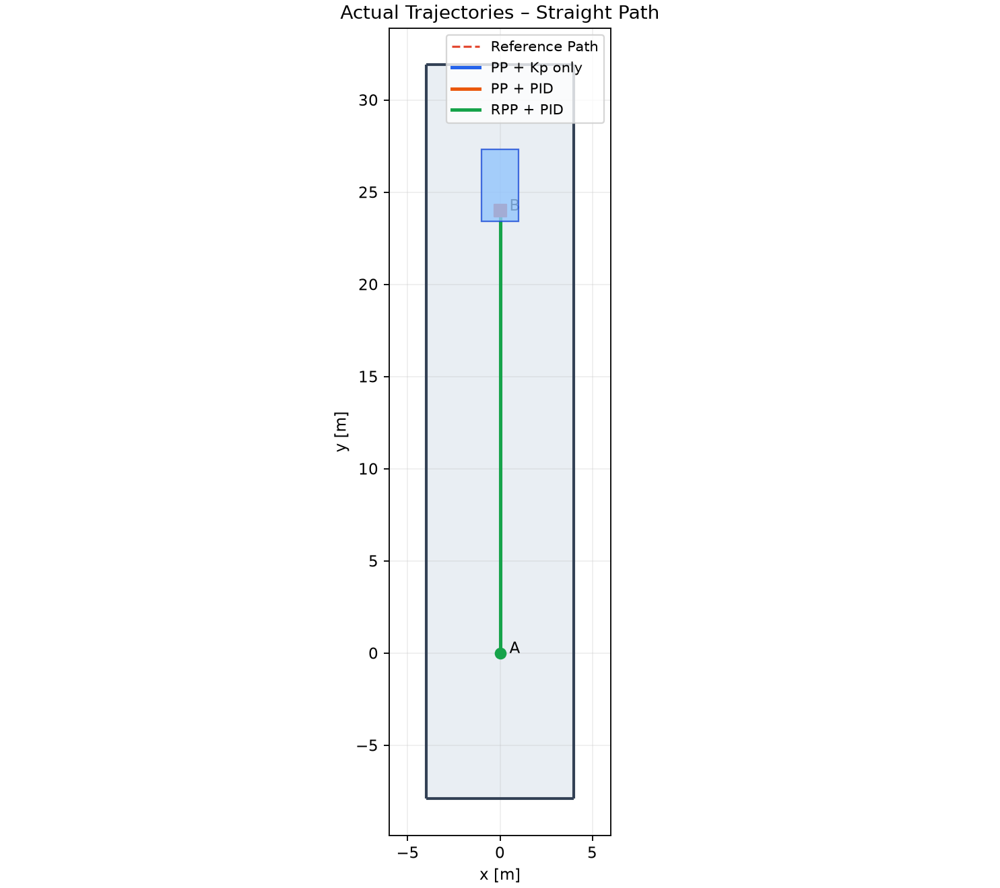

<details>
<summary><b>Xem sai số, vận tốc và chỉ tiêu đánh giá trên đường thẳng</b></summary>


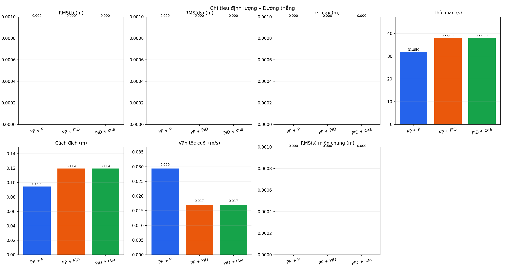

</details>

### Kịch bản 2 – Chữ L (1 cua 90°)

| PP + P | PP + PID | PP + PID + giảm tốc cua |
|:---:|:---:|:---:|
|  | 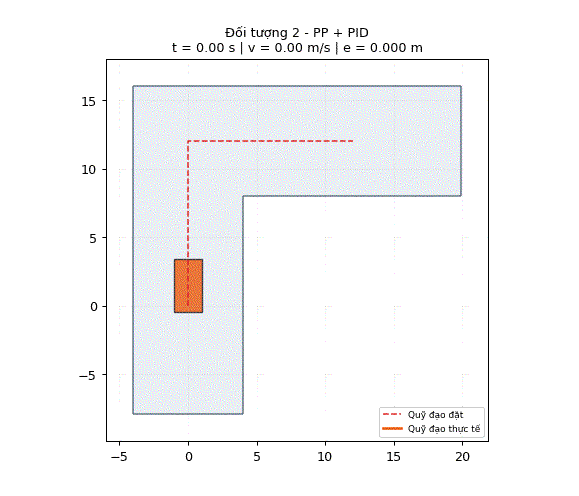 |  |

**Quỹ đạo thực tế của ba cấu hình**

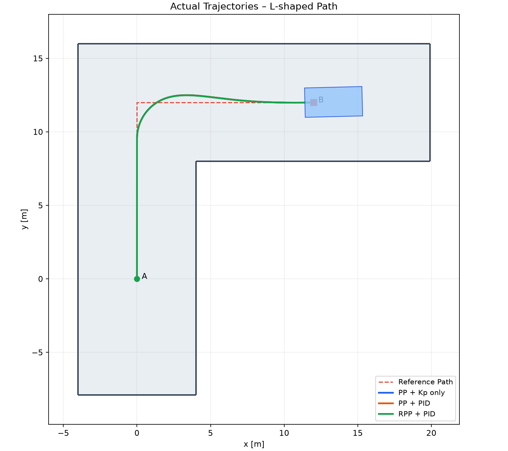

**Sai số bám đường và vận tốc**

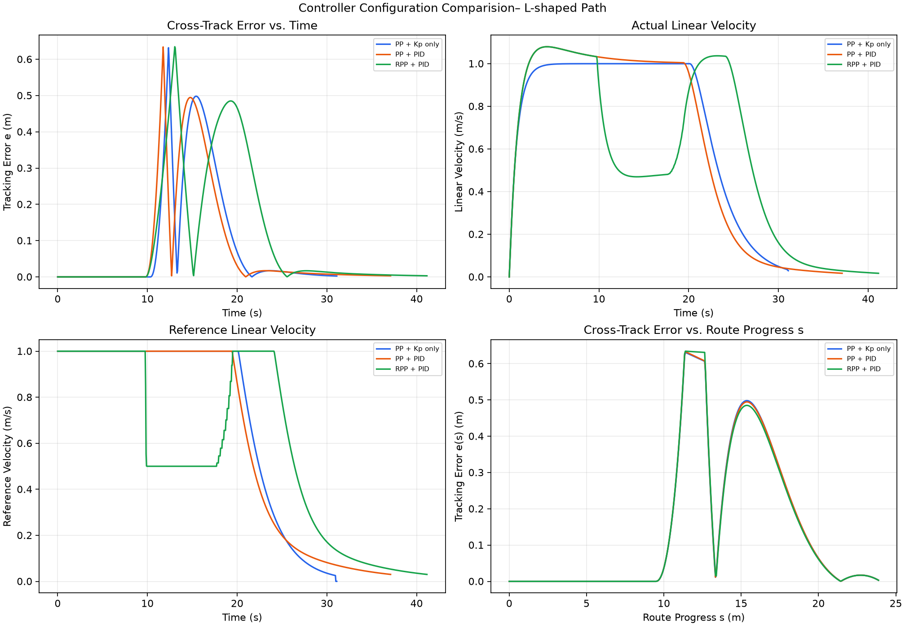

<details>
<summary><b>Xem chỉ tiêu đánh giá trên tuyến chữ L</b></summary>


</details>

### Kịch bản 3 – Zíc zắc (5 cua 90°)

| PP + P | PP + PID | PP + PID + giảm tốc cua |
|:---:|:---:|:---:|
| 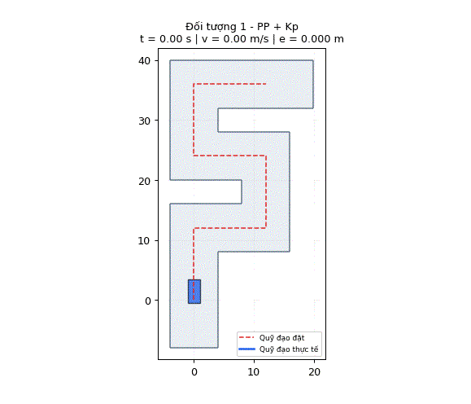 | 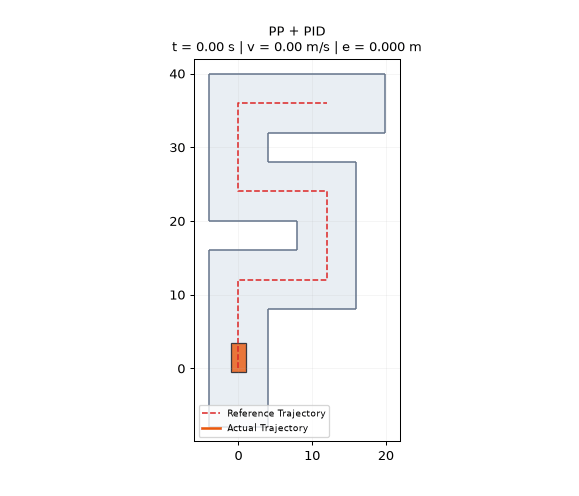 | 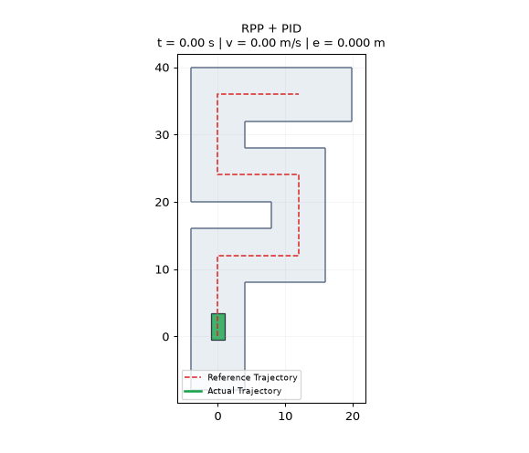 |

**Quỹ đạo thực tế của ba cấu hình**


**Sai số bám đường và vận tốc**

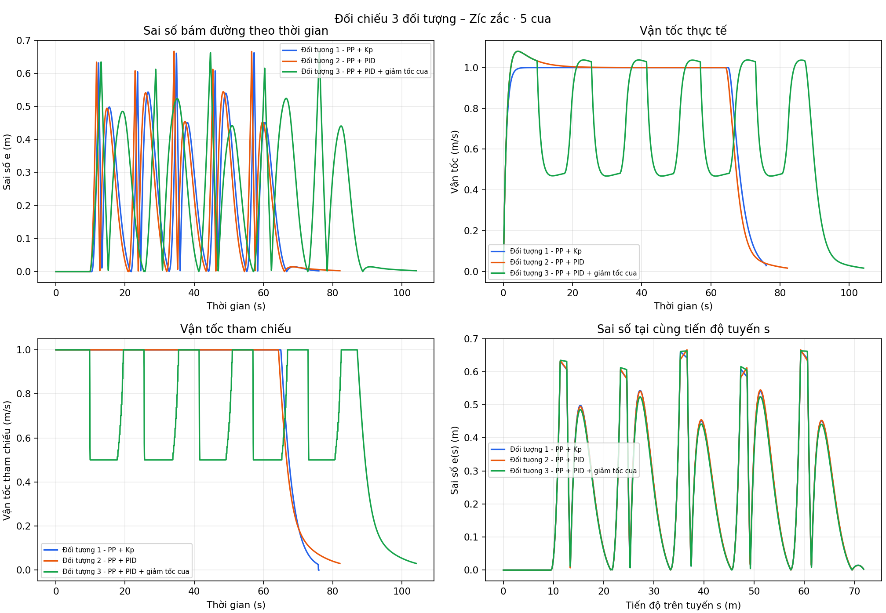

**Chỉ tiêu định lượng**

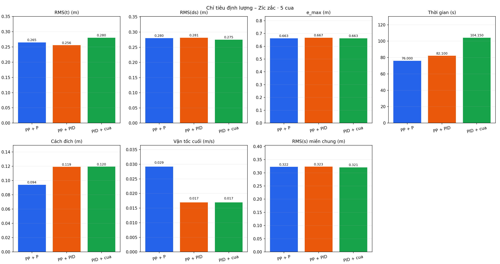

### Khảo sát khoảng nhìn trước trên tuyến zíc zắc

Khoảng nhìn trước được tính theo `Lf = Lfc + k × v`. Ba lượt khảo sát dùng cấu hình **PP + PID**, giữ `k = 0.1 s`, tắt giảm tốc theo độ cong và lần lượt đặt `Lfc = 1.5, 2.5, 4.0 m`.

<p align="center">
  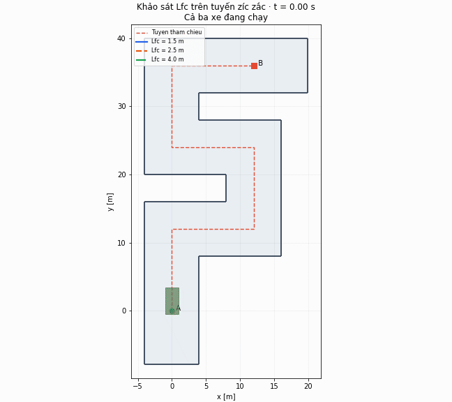
</p>

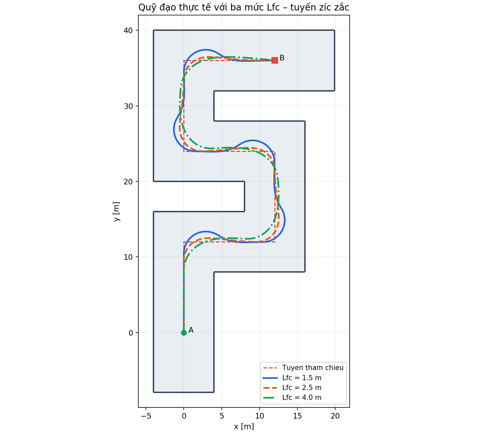

| Lfc (m) | RMS(ds) (m) | Sai số cực đại (m) | Thời gian đến đích (s) | Vượt biên |
|---:|---:|---:|---:|:---:|
| 1.5 | 0.633 | 1.426 | 87.95 | Không |
| 2.5 | **0.281** | **0.667** | 82.10 | Không |
| 4.0 | 0.448 | 1.246 | **78.50** | Không |

Trên tuyến zíc zắc, **Lfc = 2.5 m** cho sai số RMS theo quãng đường thấp nhất trong ba mức đã thử, còn **Lfc = 4.0 m** cho thời gian đến đích ngắn nhất. Cả ba lượt đều đến đích và không vượt biên.

### Tổng hợp kết quả

- [Bảng tổng hợp 9 lượt so sánh cấu hình điều khiển (CSV)](Robotics_final/Path_tracking/results/tong_hop_9_luot_chay.csv)
- [Bảng tổng hợp ba mức Lfc (CSV)](Robotics_final/Path_tracking/results/zigzag/tong_hop_3_muc_lfc.csv)
- [Thông số khảo sát Lfc (JSON)](Robotics_final/Path_tracking/results/zigzag/tham_so_lfc.json)

## 4. Mã nguồn chính

| File | Chức năng |
|---|---|
| [`main.py`](Robotics_final/Path_tracking/main.py) | Giao diện, điều phối mô phỏng và chạy kiểm thử |
| [`experiment.py`](Robotics_final/Path_tracking/experiment.py) | Chạy 9 lượt so sánh cấu hình và khảo sát ba mức Lfc, xuất GIF, PNG và CSV |
| [`parameters.py`](Robotics_final/Path_tracking/parameters.py) | Thông số mô phỏng và các tuyến tham chiếu |
| [`pure_pursuit.py`](Robotics_final/Path_tracking/pure_pursuit.py) | Chọn điểm mục tiêu và tính góc lái |
| [`pid.py`](Robotics_final/Path_tracking/pid.py) | Điều tốc P/PID và điều chỉnh vận tốc đặt theo độ cong |
| [`trajectory.py`](Robotics_final/Path_tracking/trajectory.py) | Tạo tuyến tham chiếu, kiểm tra vượt biên hành lang và vẽ quỹ đạo |

## 5. Tài liệu tham khảo

[1] R. C. Coulter, *Implementation of the Pure Pursuit Path Tracking Algorithm*, Carnegie Mellon University, Robotics Institute, 1992.

[2] S. Macenski, S. Singh, F. Martin, and J. Gines, “Regulated Pure Pursuit for Robot Path Tracking,” *Autonomous Robots*, 2023. [arXiv:2305.20026](https://arxiv.org/abs/2305.20026)

[3] P. Corke, W. Jachimczyk, and R. Pillat, *Robotics, Vision and Control: Fundamental Algorithms in MATLAB*, Springer Tracts in Advanced Robotics, vol. 147, Springer, 2023.

[4] L. Liu, M. Xue, N. Guo, Z. Wang, Y. Wang, and Q. Tang, “Investigating the path tracking algorithm based on BP neural network,” *Sensors*, vol. 23, no. 9, Art. no. 4533, 2023.

[5] K. J. Åström and R. M. Murray, *Feedback Systems: An Introduction for Scientists and Engineers*, 2nd ed., Princeton University Press, 2021, ch. 11.

[6] MathWorks, “Discrete PID Controller,” *Simulink Documentation*, truy cập ngày 20/11/2026. [Tài liệu MathWorks](https://www.mathworks.com/help/simulink/slref/discretepidcontroller.html)

---

*Mô phỏng triển khai Pure Pursuit kết hợp điều khiển vận tốc. Quy tắc giảm tốc tại cua được xây dựng dựa trên cơ chế điều chỉnh vận tốc theo độ cong của Regulated Pure Pursuit [2].*
