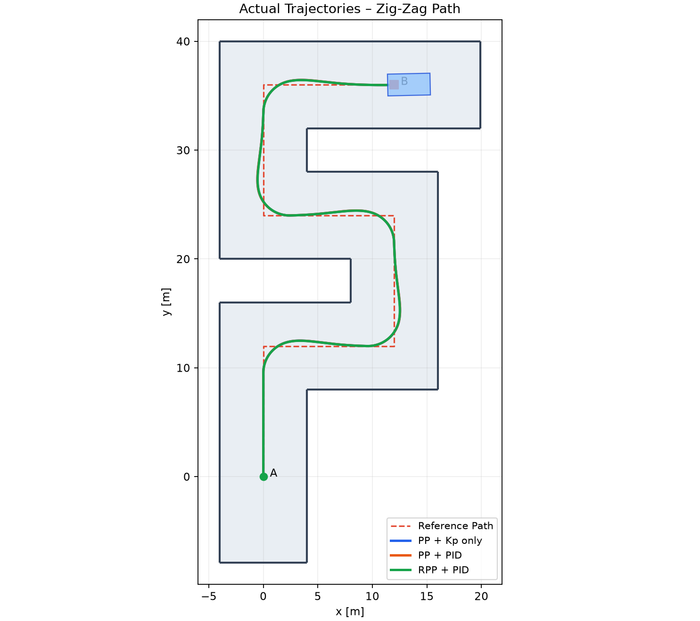
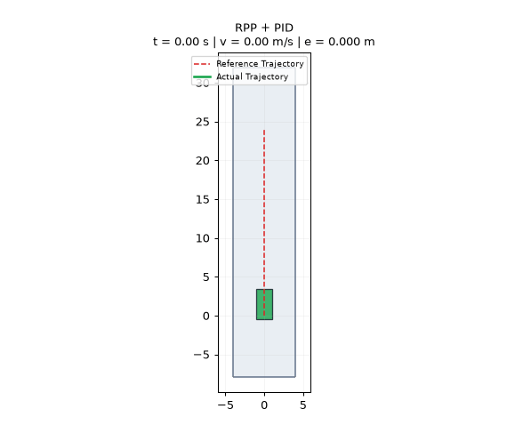
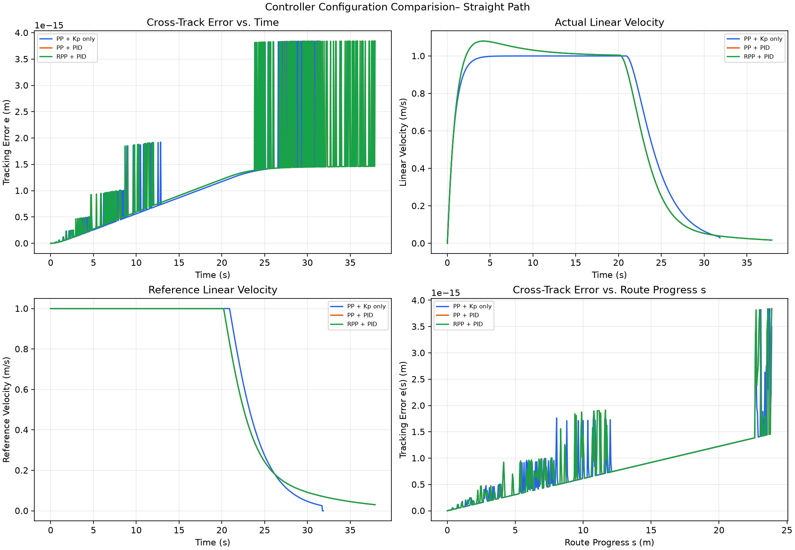
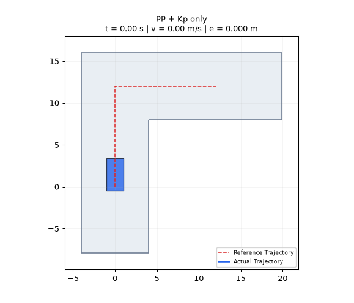
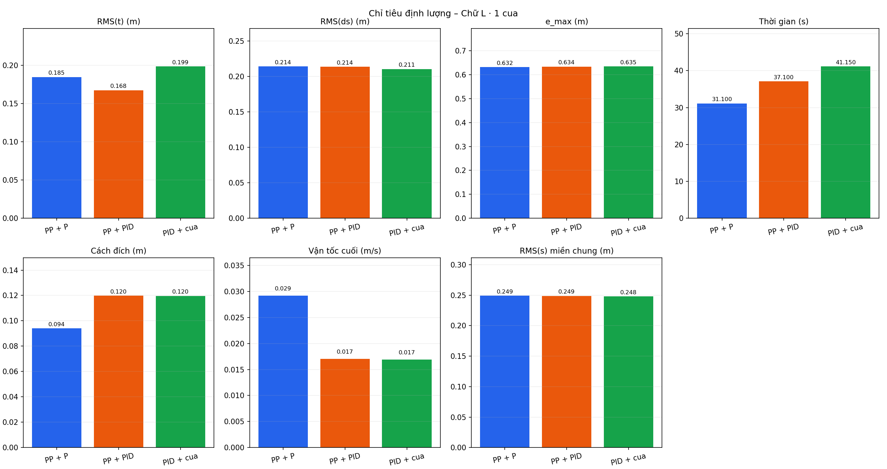

# ỨNG DỤNG THUẬT TOÁN PURE PURSUIT TRONG ĐIỀU KHIỂN ROBOT VẬN CHUYỂN HÀNG HÓA TRONG NHÀ MÁY VÀ KHO THÔNG MINH

**Đồ án môn học Kỹ thuật Robot** · **Python** · **Pure Pursuit** · **P/PID** · **Mô phỏng bám quỹ đạo**

<p align="center">
  
</p>

## 1. Nội dung đề tài

Đề tài xây dựng chương trình mô phỏng robot vận chuyển hàng hóa bám theo quỹ đạo định trước trong môi trường nhà máy và kho thông minh. Mô hình **Bicycle** mô tả chuyển động của xe; **Pure Pursuit** tính góc lái; **P/PID** điều chỉnh vận tốc. Một cấu hình còn bổ sung **giảm tốc theo độ cong** để khảo sát ảnh hưởng của tốc độ khi vào cua.

**Ba cấu hình được so sánh:**

| Đối tượng | Điều khiển hướng | Điều khiển vận tốc |
|---|---|---|
| **1 – PP + P** | Pure Pursuit | P |
| **2 – PP + PID** | Pure Pursuit | PID |
| **3 – PP + PID + giảm tốc cua** | Pure Pursuit | PID, có điều chỉnh vận tốc đặt theo độ cong |

**Ba kịch bản thí nghiệm:**

| Kịch bản | Quỹ đạo | Nội dung khảo sát |
|---|---|---|
| **1** | Đường thẳng (0 cua) | Tăng tốc, duy trì vận tốc và dừng tại đích |
| **2** | Chữ L (1 cua 90°) | Sai số bám đường và biến thiên vận tốc khi vào cua |
| **3** | Zíc zắc (5 cua 90°) | Khả năng bám đường qua các cua liên tiếp và kiểm tra vượt biên |

Các cấu hình sử dụng cùng hình học xe, quỹ đạo và giới hạn mô phỏng. Các chỉ tiêu được xuất gồm **RMS(t)**, **RMS(ds)**, **RMS(s)** trên miền tiến độ tuyến chung, **sai số lớn nhất**, **thời gian**, **khoảng cách đích**, **vận tốc cuối** và **tình trạng vượt biên hành lang**.

## 2. Hướng dẫn cài đặt và chạy

Yêu cầu **Python 3.9 trở lên**. Mở terminal tại thư mục gốc của repository và chạy:

```bash
cd Robotics_final/Path_tracking
python -m pip install numpy matplotlib pillow
```

**Mở giao diện mô phỏng:**

```bash
python main.py
```

**Chạy tự động toàn bộ 9 lượt mô phỏng (3 cấu hình × 3 kịch bản), xuất GIF, PNG, CSV:**

```bash
python main.py --experiment-all
```

**Kiểm tra các chức năng mô phỏng:**

```bash
python main.py --self-test
```

Kết quả được lưu trong `Robotics_final/Path_tracking/results/`, chia thành `straight/`, `elbow/`, `zigzag/` và bảng tổng hợp `tong_hop_9_luot_chay.csv`.

## 3. Kết quả mô phỏng trực quan

### Kịch bản 1 – Đường thẳng

| PP + P | PP + PID | PP + PID + giảm tốc cua |
|:---:|:---:|:---:|
|  |  |  |

**Quỹ đạo thực tế của ba đối tượng**


<details>
<summary><b>Xem thêm: Sai số, vận tốc và chỉ tiêu đánh giá – Đường thẳng</b></summary>




</details>

### Kịch bản 2 – Chữ L (1 cua 90°)

| PP + P | PP + PID | PP + PID + giảm tốc cua |
|:---:|:---:|:---:|
|  |  |  |

**Quỹ đạo thực tế của ba đối tượng**


**Đồ thị sai số bám đường và vận tốc**


<details>
<summary><b>Xem thêm: Chỉ tiêu đánh giá – Chữ L</b></summary>


</details>

### Kịch bản 3 – Zíc zắc (5 cua 90°)

| PP + P | PP + PID | PP + PID + giảm tốc cua |
|:---:|:---:|:---:|
|  |  |  |

**Quỹ đạo thực tế của ba đối tượng**


**Đồ thị sai số bám đường và vận tốc**


**Bảng chỉ tiêu định lượng**


### Tổng hợp kết quả

📊 **[Xem bảng tổng hợp 9 lượt chạy (CSV)](Robotics_final/Path_tracking/results/tong_hop_9_luot_chay.csv)**

Kết quả được dùng để phân tích sự đánh đổi giữa **độ chính xác bám đường**, **thời gian di chuyển** và **an toàn hành lang**. Việc bổ sung giảm tốc theo độ cong không mặc nhiên bảo đảm sai số nhỏ hơn ở mọi kịch bản; kết luận cần dựa trên các chỉ tiêu đo được.

## 4. Mã nguồn chính

| File | Chức năng |
|---|---|
| `main.py` | Giao diện, điều phối mô phỏng và chạy kiểm thử |
| `experiment.py` | Chạy 9 thí nghiệm; xuất GIF, đồ thị, CSV và báo cáo |
| `parameters.py` | Thông số mô phỏng và các quỹ đạo |
| `pure_pursuit.py` | Chọn điểm mục tiêu và tính góc lái |
| `pid.py` | Bộ điều khiển vận tốc P/PID, giảm tốc theo độ cong |
| `trajectory.py` | Tạo đường tham chiếu, đánh giá hành lang và vẽ quỹ đạo |

**Thư mục mã nguồn:** [Robotics_final/Path_tracking](Robotics_final/Path_tracking/)

## 5. Tài liệu tham khảo

[1] R. C. Coulter, *Implementation of the Pure Pursuit Path Tracking Algorithm*, Carnegie Mellon University, Robotics Institute, 1992.

[2] S. Macenski, S. Singh, F. Martin, and J. Gines, “Regulated Pure Pursuit for Robot Path Tracking,” *Autonomous Robots*, 2023. https://arxiv.org/abs/2305.20026

[3] P. Corke, W. Jachimczyk, and R. Pillat, *Robotics, Vision and Control: Fundamental Algorithms in MATLAB*, Springer Tracts in Advanced Robotics, vol. 147, Springer, 2023.

[4] L. Liu, M. Xue, N. Guo, Z. Wang, Y. Wang, and Q. Tang, “Investigating the path tracking algorithm based on BP neural network,” *Sensors*, vol. 23, no. 9, Art. no. 4533, 2023.

[5] K. J. Åström and R. M. Murray, *Feedback Systems: An Introduction for Scientists and Engineers*, 2nd ed., Princeton University Press, 2021, ch. 11.

[6] MathWorks, “Discrete PID Controller,” *Simulink Documentation*. https://www.mathworks.com/help/simulink/slref/discretepidcontroller.html (truy cập ngày 20/11/2026).

---

*Lưu ý: Đây là mô phỏng Pure Pursuit kết hợp điều khiển vận tốc và cơ chế giảm tốc theo độ cong; chưa phải triển khai đầy đủ Regulated Pure Pursuit của ROS 2 Nav2.*
